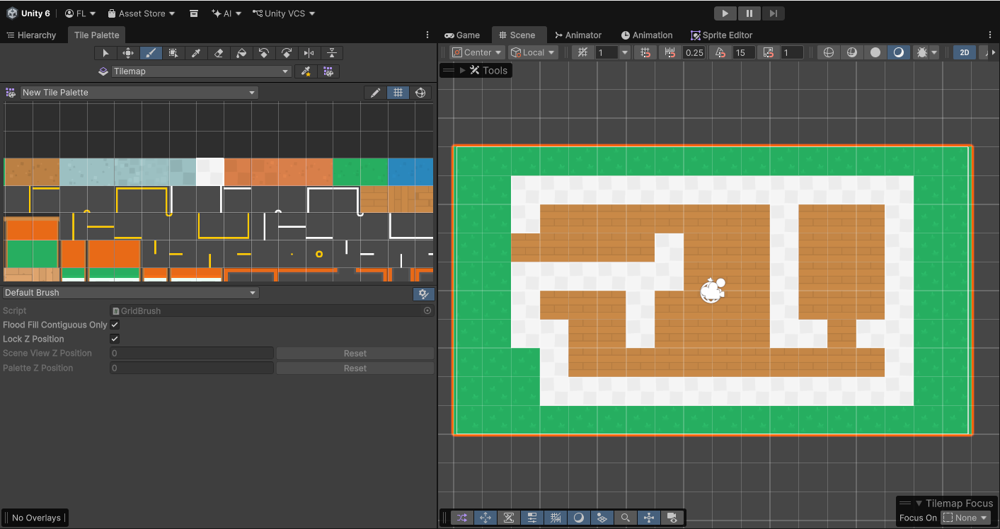
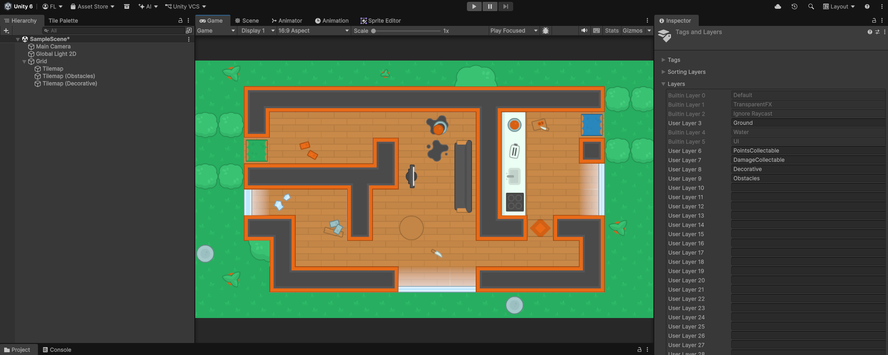
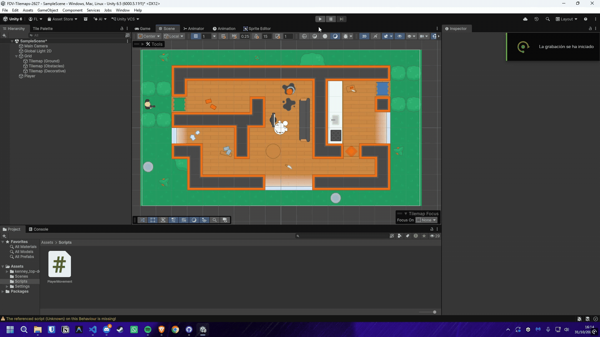
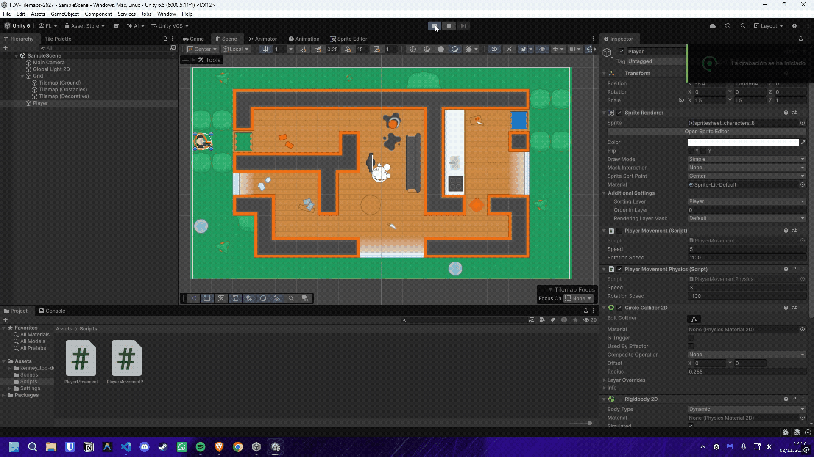
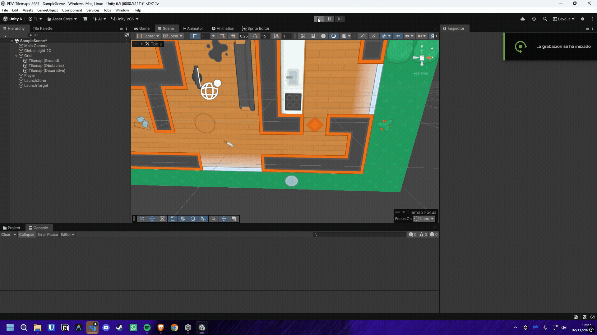
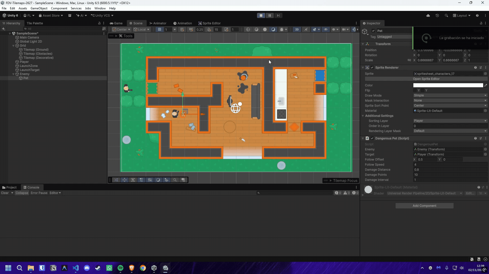

# FDV-Tilemaps-2627

## Ejercicio 1

1. En esta primera tarea de la práctica, trabajaremos con los elementos fundamentales del mapa de juego, se debe trabajar con los objetos:
- Grid
- Tilemap
- Tile Palette

**Actividades a realizar:**
 
Partiendo de la escena implementada para la tarea de Sprites  construiremos un mapa de juego, que delimitará la zona en la que tendrá lugar la acción. Utiliza los recursos en el paquete generado para la práctica.Debes crear una paleta con los Tiles que consideres. Ajusta el tamaño de los Tiles al tamaño de celda del grid y subdivide aquellos Tiles que ocupen un grupo de celdas. Generar un mapa convencional que represente el entorno y límites de juego.

***Para este ejercicio decidí crear un mapa base con sprites para un juego Top-View, en el que se representa una casa con sus delimitaciones de paredes, suelo y jardin.***



## Ejercicio 2

2. En este ejercicio se trabaja con el uso de varios Tilemaps en la misma escena, cada uno tendrá un orden de renderizado diferente, por lo que puede afectar a su visibilidad. Si te surgen problemas puedes actuar en el orden de la capa También es conveniente revisar el valor de Z, una ayuda puede ser la visualización 3D del proyecto.

**Actividades a realizar:**

- Crea dos Tilemaps adicionales de obstáculos. Uno puede representar elementos decorativos y otro obstáculos.
- Agrega a la capa de obstáculos la configuración necesaria para que el Tilemap se construya de forma independiente y el obstáculo actúe como tal. Esto puede dar problemas por diferentes causas:
    - Velocidad del renderizado muy alta: Activa detección de colisiones continua
    - Orden de las capas
    - Las capas permiten colisiones entre sí.
    - Tamaño y forma de los colliders. Se puede corregir editando el Sprite para adaptar la forma al objeto y aplicar Custom Physics Shape
    - Si has modificado la escala puede afectar a la detección de colisiones.
- Agrega una capa de objetos recolectables que hagan sumar puntos al jugador, y otra de objetos que hacen daño que le resten puntos.

***Tras agregar los Tilemaps, se configuraron las múltiples capas necesarias para distinguir la renderización de cada tipo de elemento en el juego. Se agregaron los colliders a los elementos que se consideraron obstáculos y se configuraron las capas de objetos recolectables y dañinos.***

***Una vez configuradas las capas y los colliders, se colocaron los tiles de distintos tipos para darle más vida al mapa, teniendo objetos tirados por el suelo, obstaculos dentro de la casa, y paredes que delimitan la zona de juego.***



## Ejercicio 3

3. El último bloque de tareas con el que trabajaremos será implementar algunas mecánicas útiles. 

    Control de Movimiento 2D: En cada actualización, mediante el método Update(){ } avanzaremos el espacio que nos permite una velocidad speed, en el tiempo transcurrido. El intervalo de tiempo entre frames lo controla Time.deltaTime. Utiliza los ejes para dirigir la orientación del movimiento.
    
    Control del personaje 2D con rotación y avance hacia adelante: En cada actualización, mediante el método Update(){ } avanzaremos siempre hacia adelante el espacio que nos permite una velocidad speed, en el tiempo transcurrido. El eje X se usa para rotar y orientarnos hacia donde queremos caminar. El eje Y se usa para avanzar una vez que estamos orientados.

***Para este ejercicio se implementó un control de movimiento 2D con rotación y avance hacia adelante, en el que el jugador puede moverse por el mapa con las teclas WASD:***

```csharp
public class PlayerMovement : MonoBehaviour
{
    [SerializeField] private float speed = 3f;
    [SerializeField] private float rotationSpeed = 1100f;

    private void Update()
    {
        float horizontal = Input.GetAxis("Horizontal");
        float vertical = Input.GetAxis("Vertical");
        Vector3 movement = new Vector3(horizontal, vertical, 0f);

        if (movement.sqrMagnitude == 0f)
        {
            return;
        }

        movement.Normalize();
        transform.position += movement * speed * Time.deltaTime;

        float targetAngle = Mathf.Atan2(movement.y, movement.x) * Mathf.Rad2Deg;
        Quaternion targetRotation = Quaternion.Euler(0f, 0f, targetAngle);
        transform.rotation = Quaternion.RotateTowards(
            transform.rotation,
            targetRotation,
            rotationSpeed * Time.deltaTime);
    }
}
```



## Ejercicio 4

4. Desarrolla un script de movimiento del jugador asumiendo que responde a físicas.

***Para este ejercicio se implementó un control de movimiento 2D con rotación y avance hacia adelante, en el que el jugador puede moverse por el mapa con las teclas WASD, pero esta vez utilizando físicas para el movimiento y las colisiones:***

```csharp
public class PlayerMovementPhysics : MonoBehaviour
{
    [SerializeField] private float speed = 3f;
    [SerializeField] private float rotationSpeed = 1100f;

    private Rigidbody2D body;
    private Vector2 movement;

    private void Awake()
    {
        body = GetComponent<Rigidbody2D>();
        body.gravityScale = 0f;
    }

    private void Update()
    {
        movement = new Vector2(
            Input.GetAxis("Horizontal"),
            Input.GetAxis("Vertical"));

        if (movement.sqrMagnitude > 1f)
        {
            movement.Normalize();
        }
    }

    private void FixedUpdate()
    {
        body.linearVelocity = movement * speed;

        if (movement.sqrMagnitude == 0f)
        {
            return;
        }

        float targetAngle = Mathf.Atan2(movement.y, movement.x) * Mathf.Rad2Deg;
        float nextAngle = Mathf.MoveTowardsAngle(
            body.rotation,
            targetAngle,
            rotationSpeed * Time.fixedDeltaTime);
        body.MoveRotation(nextAngle);
    }
}
```

***Por motivos de comodidad en el movimiento, se decidió utilizar un Circle Collider 2D para el jugador, ya que de esta manera se puede mover con mayor facilidad por el mapa y no se queda atascado en las esquinas de los colliders de los objetos.***



## Ejercicio 5

5. Agrega un objeto que ocupe un área que lance al jugador hacia otra zona del mapa.

***Para este ejercicio se creó una zona de lanzamiento mediante un `Box Collider 2D` configurado como `Is Trigger`. Al entrar el jugador en el área, el objeto calcula la dirección hacia un punto de destino y llama al método `Launch` del movimiento físico.***

***El jugador debe tener el tag `Player`, un `Rigidbody2D`, un collider 2D y el componente `PlayerMovementPhysics`. El objeto de la zona necesita un `Box Collider 2D` con `Is Trigger` activado y el campo `target` debe apuntar a un objeto situado en la zona de destino.***

```csharp
using UnityEngine;

public class LaunchZone : MonoBehaviour
{
    [SerializeField] private Transform target;
    [SerializeField] private float launchForce = 12f;
    [SerializeField] private float launchDuration = 0.5f;

    private void OnTriggerEnter2D(Collider2D other)
    {
        Rigidbody2D playerBody = other.attachedRigidbody;

        if (playerBody == null || !other.CompareTag("Player"))
        {
            return;
        }

        PlayerMovementPhysics playerMovement =
            playerBody.GetComponent<PlayerMovementPhysics>();

        if (playerMovement == null || target == null)
        {
            return;
        }

        Vector2 direction =
            ((Vector2)target.position - playerBody.position).normalized;
        playerMovement.Launch(direction * launchForce, launchDuration);
    }
}
```

***El método `Launch` mantiene el control del impulso durante el tiempo indicado para evitar que el movimiento normal del jugador sobrescriba la velocidad de lanzamiento:***

```csharp
public void Launch(Vector2 velocity, float duration)
{
    launchVelocity = velocity;
    launchTimeRemaining = Mathf.Max(0f, duration);
    rb.linearVelocity = velocity;
}
```



## Ejercicio 6

6. Crea un enemigo que persiga al jugador, que arrastre una mascota peligrosa. Si el jugador está a una distancia mínima, la mascota rabiosa hará que pierda puntos.

***Para este ejercicio se creó un enemigo que persigue al jugador mediante un `Rigidbody2D` y una mascota que se mantiene detrás de él. Cuando la mascota se aproxima al jugador, le resta puntos respetando un intervalo de daño para no descontarlos en cada frame.***

***El jugador tiene el tag `Player` y `PlayerScore`. El enemigo necesita `Rigidbody2D`, un collider 2D y `EnemyChase`. La mascota es hija del enemigo y tener el componente `DangerousPet`.***

```csharp
public class PlayerScore : MonoBehaviour
{
    [SerializeField] private int points = 100;

    public int Points => points;

    public void LosePoints(int amount)
    {
        if (amount <= 0)
        {
            return;
        }

        points = Mathf.Max(0, points - amount);
        Debug.Log($"Player points: {points}");
    }
}
```

```csharp
[RequireComponent(typeof(Rigidbody2D))]
public class EnemyChase : MonoBehaviour
{
    [SerializeField] private Transform target;
    [SerializeField] private float speed = 2f;
    [SerializeField] private float rotationSpeed = 360f;

    private Rigidbody2D body;

    private void Awake()
    {
        body = GetComponent<Rigidbody2D>();
        body.gravityScale = 0f;
    }

    private void Start()
    {
        if (target == null)
        {
            GameObject player = GameObject.FindGameObjectWithTag("Player");
            if (player != null)
            {
                target = player.transform;
            }
        }

        if (target == null)
        {
            Debug.LogError("EnemyChase needs a target or a Player-tagged object.", this);
        }
    }

    private void FixedUpdate()
    {
        if (target == null)
        {
            return;
        }

        Vector2 direction = ((Vector2)target.position - body.position).normalized;
        body.MovePosition(body.position + direction * speed * Time.fixedDeltaTime);

        if (direction.sqrMagnitude == 0f)
        {
            return;
        }

        float targetAngle = Mathf.Atan2(direction.y, direction.x) * Mathf.Rad2Deg;
        float nextAngle = Mathf.MoveTowardsAngle(
            body.rotation,
            targetAngle,
            rotationSpeed * Time.fixedDeltaTime);
        body.MoveRotation(nextAngle);
    }
}
```

```csharp
public class DangerousPet : MonoBehaviour
{
    [SerializeField] private Transform enemy;
    [SerializeField] private Transform target;
    [SerializeField] private Vector2 followOffset = new(0.5f, 0.0f);
    [SerializeField] private float followSpeed = 4f;
    [SerializeField] private float damageDistance = 0.8f;
    [SerializeField] private int damagePoints = 10;
    [SerializeField] private float damageInterval = 1f;

    private float damageCooldown;

    private void Start()
    {
        if (enemy == null && transform.parent != null)
        {
            enemy = transform.parent;
        }

        if (target == null)
        {
            GameObject player = GameObject.FindGameObjectWithTag("Player");
            if (player != null)
            {
                target = player.transform;
            }
        }
    }

    private void Update()
    {
        if (enemy == null || target == null)
        {
            return;
        }

        Vector2 desiredPosition = (Vector2)enemy.position + followOffset;
        transform.position = Vector2.MoveTowards(
            transform.position,
            desiredPosition,
            followSpeed * Time.deltaTime);

        damageCooldown -= Time.deltaTime;
        if (damageCooldown > 0f)
        {
            return;
        }

        if (Vector2.Distance(transform.position, target.position) <= damageDistance)
        {
            PlayerScore score = target.GetComponent<PlayerScore>();
            if (score == null)
            {
                Debug.LogError("The player needs a PlayerScore component.", target);
                return;
            }

            score.LosePoints(damagePoints);
            damageCooldown = damageInterval;
        }
    }
}
```

